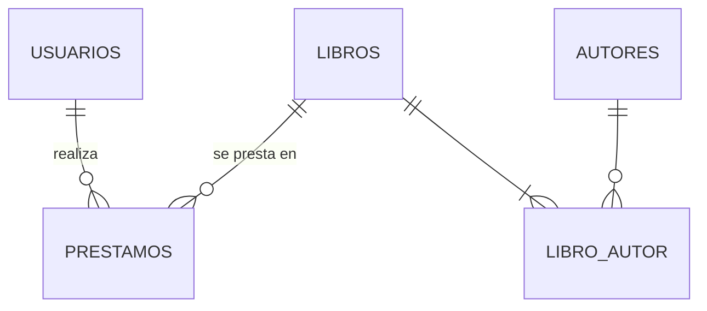

# Documentación · Producto 2 (FP065) · Biblioteca

Alumna: **Andrea Valero Sanz**. Aplicación de gestión de biblioteca con Spring Boot + Spring Data JPA +
Thymeleaf + MariaDB + Docker.

## Contenido

| Carpeta / archivo | Qué contiene |
|---|---|
| [`memoria/producto2(FP065)_ValeroSanz_Andrea.docx`](memoria/) | **Memoria** de la práctica (Word) |
| `memoria/producto2(FP065)_ValeroSanz_Andrea.pdf` | La misma memoria en PDF |
| `memoria/generar_memoria.py` | Script que genera el DOCX (python-docx); cita los ficheros reales del repo |
| `memoria/exportar_pdf.py` | Exporta el DOCX a PDF con LibreOffice actualizando el índice |
| `memoria/capturas/` | Capturas reales de la app que se insertan en la memoria (ver su README) |
| [`diagramas/er_chen.png`](diagramas/er_chen.png) · `.svg` · `.drawio` | Diagrama **Entidad/Relación** en notación Chen |
| [`diagramas/relacional.png`](diagramas/relacional.png) · `.svg` · `.mmd` | **Modelo relacional** (tablas, PK, FK) |
| `diagramas/generar_diagramas.py` | Generador de los diagramas (SVG + PNG + draw.io) |
| [`mockups/index.html`](mockups/index.html) | **Mockups** (wireframes HTML) de las 8 pantallas |
| `mockups/png/` | Mockups exportados a PNG |

## Modelo de datos



- `usuarios`(id, nombre, apellidos, email UQ, telefono, fecha_alta)
- `libros`(id, titulo, isbn UQ, editorial, anio_publicacion, ejemplares_disponibles)
- `autores`(id, nombre, nacionalidad)
- `libro_autor`(libro_id FK, autor_id FK) → relación **N:M** Libro–Autor
- `prestamos`(id, usuario_id FK, libro_id FK, fecha_prestamo, fecha_devolucion_prevista, fecha_devolucion NULL, estado)

## Mockups

| Pantalla | Ruta | PNG |
|---|---|---|
| Inicio / dashboard | `/` | [01](mockups/png/01-dashboard.png) |
| Listado de libros | `/libros` | [02](mockups/png/02-libros-listado.png) |
| Formulario de libro | `/libros/nuevo`, `/libros/{id}/editar` | [03](mockups/png/03-libro-formulario.png) |
| Listado de préstamos | `/prestamos` | [04](mockups/png/04-prestamos-listado.png) |
| Nuevo préstamo | `/prestamos/nuevo` | [05](mockups/png/05-prestamo-formulario.png) |
| Listado de usuarios | `/usuarios` | [06](mockups/png/06-usuarios-listado.png) |
| Formulario de usuario | `/usuarios/nuevo` | [07](mockups/png/07-usuario-formulario.png) |
| Listado de autores | `/autores` | [08](mockups/png/08-autores-listado.png) |

## Regenerar

```bash
# diagramas y mockups (python3 + google-chrome headless)
python3 docs/diagramas/generar_diagramas.py
python3 docs/mockups/generar_mockups.py && docs/mockups/export_png.sh

# memoria (python-docx en un entorno virtual; LibreOffice para el PDF)
python3 -m venv /tmp/docvenv && /tmp/docvenv/bin/pip install python-docx
/tmp/docvenv/bin/python docs/memoria/generar_memoria.py
python3 docs/memoria/exportar_pdf.py
```

## Pendiente antes de entregar

- [x] Capturas reales de la app en `memoria/capturas/` (11 imágenes) insertadas en la memoria.
- [ ] Publicar el vídeo en YouTube y poner el enlace en `VIDEO_URL` (`memoria/generar_memoria.py`), regenerar DOCX y PDF.

Repositorio (privado): https://github.com/andreavalerosanz-rgb/biblioteca-p2
